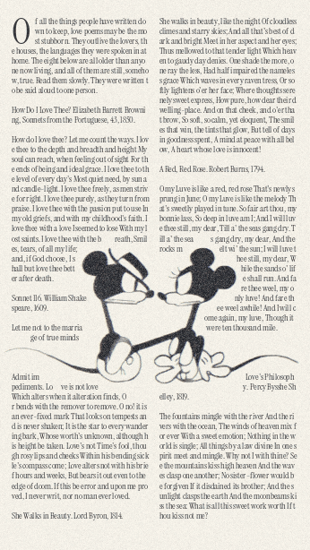
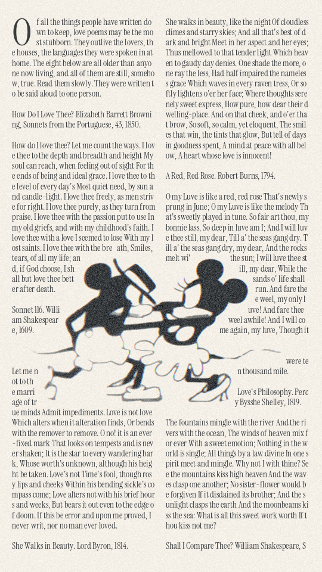
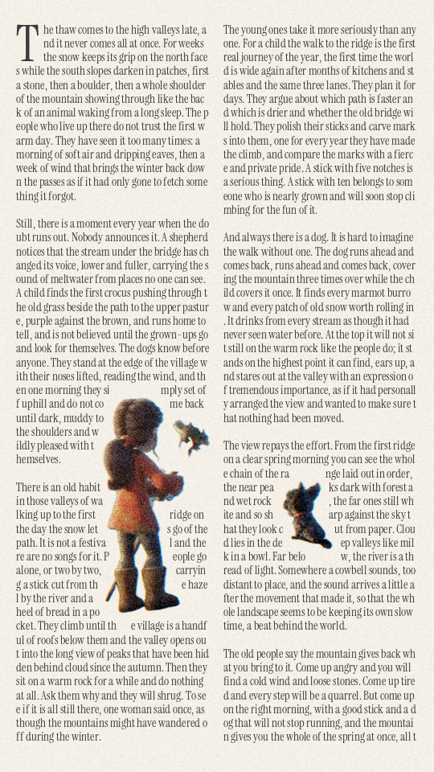
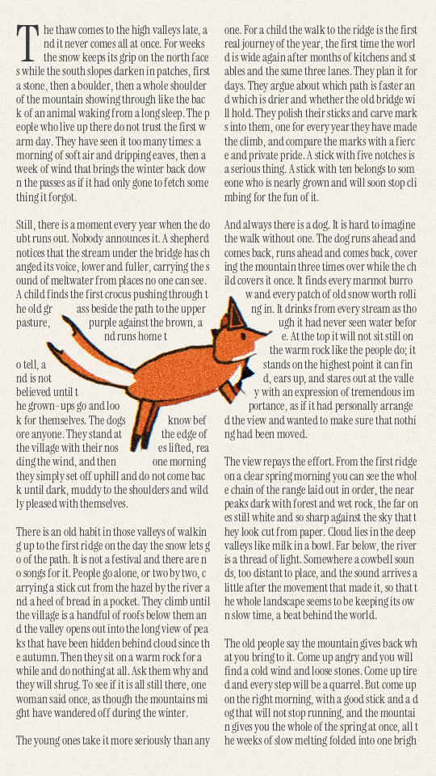
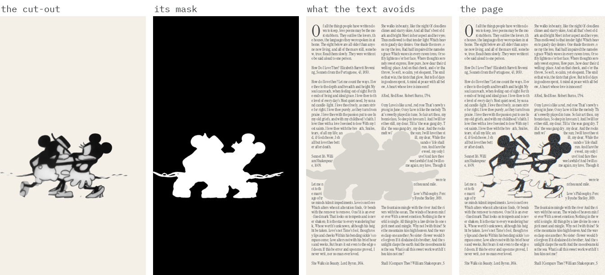

# Runaround

A page of newspaper text with a figure living inside it. Every frame the text
gets out of the figure's way: each line is cut where the figure is and poured
into what is left, so the columns flow around the silhouette. Typesetters call
text wrapped around a picture a *runaround*; here the picture never stops
moving.

  

  <a href="https://monex00.github.io/runaround/"><b>Open the notebook in your browser</b></a>
  &nbsp;·&nbsp; nothing to install, it runs on Pyodide

  
  
  

The whole thing is one reactive [marimo](https://marimo.io) notebook,
`runaround.py`. It opens on a playground (pick a figure or drop in your own
cut-out, pick a text, and watch the loop; change the type or the margin and
press *make the loop* to see your own page move) and then explains, one idea
per section, how the page is built, on two seconds of the same figure:

  

The mask is grown by a margin $m$ (in ems of the type size $s$), and a pixel
$p$ is closed to the text when

$$
d(p) \le m \cdot s ;
$$

each line keeps the free spans left beside the figure, and one fixed stream of
letters is poured into them, column by column. A latch in time (a pixel is
given back only when the figure has moved half an em further) and edges that
move in quarter-em steps keep the text from trembling with the silhouette;
the notebook charts how many lines each of them saves.

## Run

    uv run marimo edit runaround.py

or, read-only, `uv run marimo run runaround.py`. Python 3.12+.

Your own figure: any PNG or WebP with a transparent background, or an animated
GIF, dropped into the playground.

## Your own figure, on a GPU (optional)

`cutout.py` is a second notebook that does run models: pick a video and a
shot, check the boxes BiRefNet puts around the figure on the first frame (or
drag your own), and SAM 2 follows them through the shot. It shows the masks
on the page and gives back the cut-out as an animated WebP for the
playground. It needs a GPU (a few seconds of video take under a minute) and
the `reels` group:

    uv sync --group reels
    uv run marimo edit cutout.py

Or open it on [molab](https://molab.marimo.io) with the badge above: sign in,
press *Run it now*, attach the GPU from the notebook's specs button, then run
the cells. The first cut-out downloads the models (about 1 GB) and takes a
minute longer; molab keeps nothing when the session ends, so download the
cut-out.

## Reels (optional)

The same functions draw 9:16 reels. To make one from a video of your own:

    uv sync --group reels                               # torch, BiRefNet, SAM 2 (GPU)
    uv run python tools/masks.py <piece> --method birefnet-general
    uv run python tools/render.py <piece> --draft       # 1080x1920
    uv run python tools/render.py <piece>               # 2160x3840

The fonts, texts and demo figures the notebook reads live in `public/`,
which GitHub Pages serves next to the page. A piece is an entry of `pieces.toml`: which clip in `clips/`, which seconds,
which text, and any of the notebook's dataclasses (`[piece.place]`,
`[piece.look]`, ...). `clips/`, `masks/` and `out/` are not part of the repo.

## Sources

- Demo figures: *The Gallopin' Gaucho* (1928), US public domain; *Spring*,
  Blender Studio (2019), [CC-BY 4.0](https://studio.blender.org/films/spring/);
  the fox is our own drawing (`figures/fox`, made with HyperFrames).
- Texts: love poems by Elizabeth Barrett Browning, Shakespeare, Byron, Burns,
  Shelley and Yeats (public domain); Articles 10-12 of the *Declaration of the
  Rights of Man and of the Citizen* (1789), our translation; the rest our own.
- Fonts: Instrument Serif and IBM Plex Mono, SIL Open Font License
  (`public/fonts/OFL-*.txt`).

## License

Code: MIT (`LICENSE`). Fonts: SIL OFL 1.1. Demo figures: as credited above.
